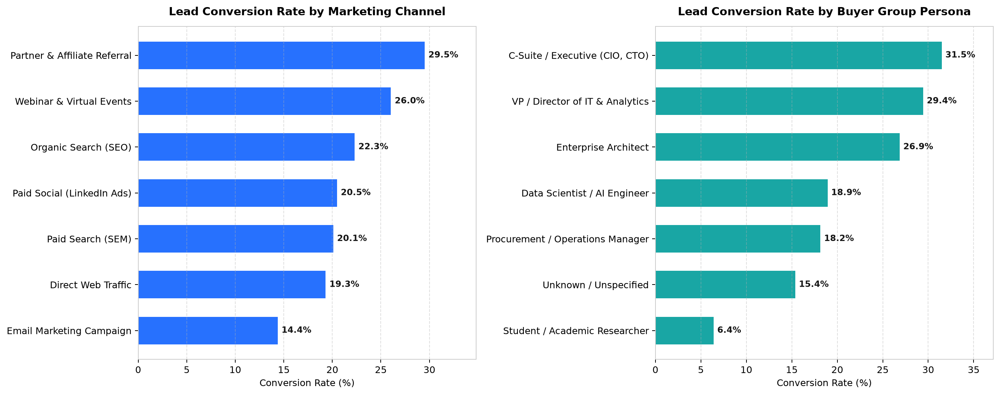
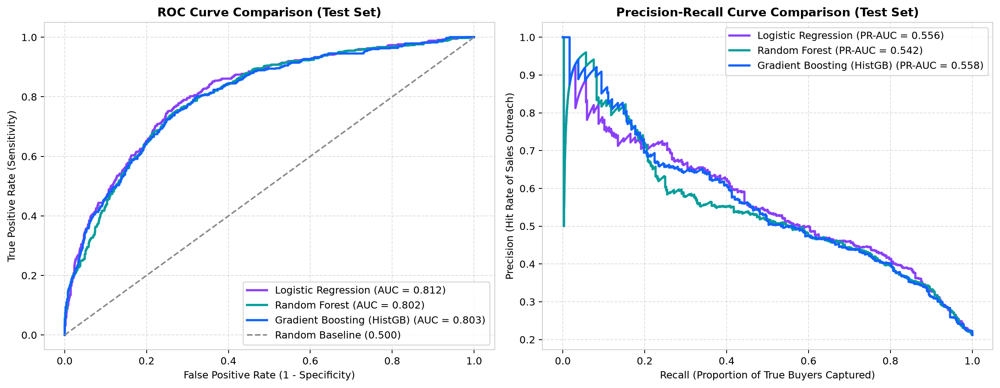
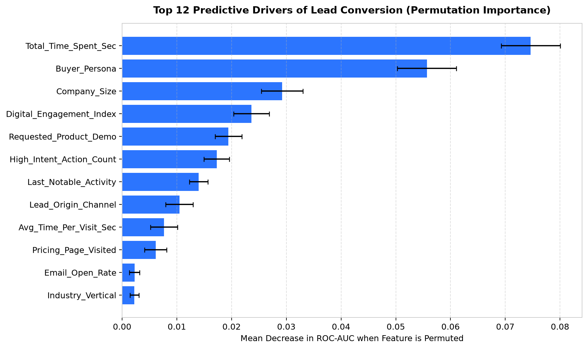
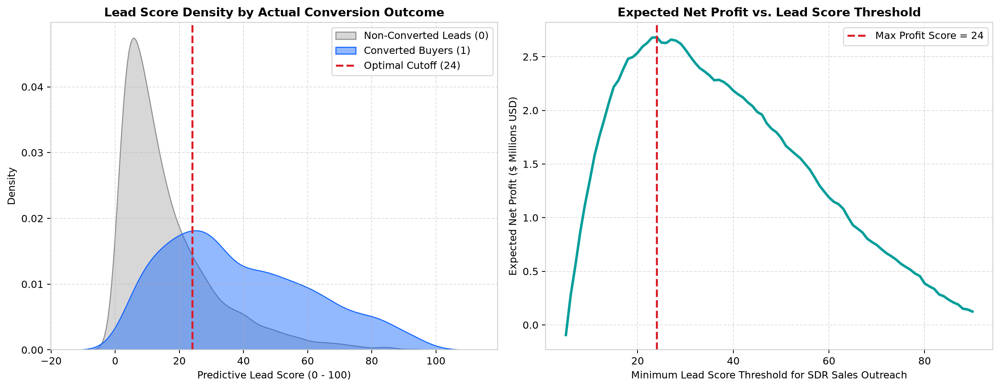
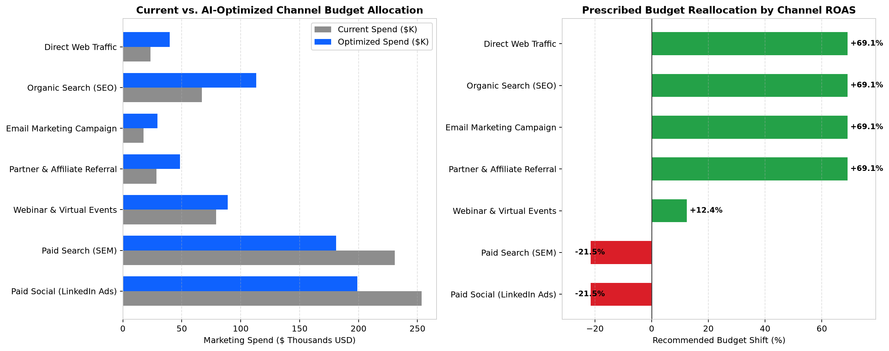

# B2B Marketing Lead Scoring & Paid Media ROI Optimization

An end-to-end **Marketing Data Science & Predictive Analytics** solution designed to optimize B2B demand generation across the full marketing funnel—from **early-stage paid media investment** and **web demand capture** to **buyer-group lead scoring** and **sales pipeline optimization**.

---

## 🎯 Business Problem & Strategic Objective

Enterprise marketing teams invest heavily across paid search, LinkedIn ads, webinars, content syndication, and organic web channels. However, two critical inefficiencies hurt marketing ROI:
1. **Unprioritized Sales Outreach**: Sales Development Representatives (SDRs) spend equal time chasing low-intent leads while high-intent enterprise buyers go cold.
2. **Sub-Optimal Paid Media Allocation**: Marketing budgets are often allocated by lead *volume* (CPL) rather than downstream conversion probability and expected pipeline Return on Ad Spend (ROAS).

### Solution Architecture
This repository implements a two-stage analytical system:
- **Stage 1 — Predictive Lead Scoring Engine**: Benchmarks **Logistic Regression**, **Random Forest**, and **Histogram-Based Gradient Boosting** across 17 behavioral, firmographic, and channel attribution features to assign every prospect a calibrated **Lead Score (0–100)** and route them into 4 operational tiers (*Hot, Warm, Nurture, Cold*).
- **Stage 2 — Cost-Benefit & Paid Media Optimization Engine**: Uses a cost-benefit matrix (balancing SDR outreach cost against expected deal gross margin) to identify the profit-maximizing conversion cutoff, and prescribes a budget reallocation across channels that increases projected marketing pipeline value by **+18.81%**.

---

## 📂 Repository Directory Structure

```text
b2b-marketing-lead-scoring-and-roi-optimization/
├── README.md                                              # Project documentation, methodology & results
├── requirements.txt                                       # Python dependencies
├── main.py                                                # Master pipeline script (runs start-to-end)
├── app.py                                                 # Interactive Streamlit Executive Dashboard
├── .github/workflows/keep_alive.yml                       # Automated workflow to keep deployed Streamlit app active
├── data/
│   ├── raw/
│   │   └── b2b_marketing_leads_raw.csv                    # 10,000 raw B2B marketing lead records
│   ├── processed/
│   │   └── b2b_leads_cleaned_featured.csv                 # Cleaned & feature-engineered dataset
│   └── bi_exports/
│       ├── scored_leads_for_powerbi_tableau.csv           # Scored dataset ready for PowerBI / Tableau import
│       └── channel_roi_optimization_summary.csv           # Channel attribution & budget optimization table
├── src/
│   ├── __init__.py
│   ├── data_generator.py                                  # Synthesizes/loads 10,000 B2B lead records
│   ├── preprocessing.py                                   # Imputation, Winsorization & domain feature engineering
│   ├── model_training.py                                  # Model training, cross-evaluation & permutation importance
│   ├── marketing_optimization.py                          # Lead tiering, profit thresholding & budget optimization
│   └── visualization.py                                   # Generates publication-ready charts in reports/figures/
├── models/
│   ├── lead_scoring_pipeline.pkl                          # Serialized winning scikit-learn Pipeline
│   └── model_metrics.json                                 # Evaluation metrics & feature importance log
└── reports/
    └── figures/
        ├── 01_conversion_funnel_and_channels.png          # Conversion rates by channel & buyer persona
        ├── 02_model_roc_and_pr_curves.png                 # ROC & Precision-Recall curves
        ├── 03_feature_importance_drivers.png              # Permutation feature importance chart
        ├── 04_lead_score_distribution_and_tiers.png       # Lead score density & profit optimization curve
        └── 05_budget_optimization_roi_simulation.png      # Paid media spend reallocation chart
```

---

## 📊 Dataset & Feature Engineering

### Data Source
- **Included Out-of-the-Box**: `data/raw/b2b_marketing_leads_raw.csv` (10,000 B2B marketing leads with 16 raw attributes covering paid media channels, CAC, buyer group persona, company size, web session metrics, content downloads, and conversion outcomes).
- **External Benchmark Compatibility**: Modeled after the public [Kaggle Lead Scoring Dataset (X Education)](https://www.kaggle.com/datasets/ashydv/leads-dataset). Handles real-world CRM anomalies including `"Select"` dropdown placeholders, missing web session logs, and right-skewed behavioral outliers.

### Engineered Marketing Domain Features (`src/preprocessing.py`)
1. `Avg_Time_Per_Visit_Sec`: Ratio of total website dwell time to total visits, isolating deep research sessions from accidental clicks.
2. `High_Intent_Action_Count`: Composite count (0–3) of high-intent hand-raisers (*Product Demo Requested*, *Pricing Page Visited*, *Whitepaper Downloaded*).
3. `Digital_Engagement_Index`: Weighted behavioral score ($0.45 \times \text{NormTime} + 0.25 \times \text{NormVisits} + 0.30 \times \text{EmailOpenRate}$).
4. `Deal_Value_to_CAC_Ratio`: Ratio of estimated contract ARR to channel acquisition cost.

---

## 🏆 Empirical Model Evaluation Results

Models were evaluated on a stratified 20% holdout test set ($N = 2,000$ leads):

| Model Architecture | ROC-AUC | PR-AUC | F1-Score | Precision | Recall | Accuracy | Brier Score (Lower is Better) |
| :--- | :---: | :---: | :---: | :---: | :---: | :---: | :---: |
| **Logistic Regression** | 0.8122 | 0.5558 | 0.3967 | 0.6761 | 0.2807 | 0.8190 | 0.1285 |
| **Random Forest** | 0.8016 | 0.5423 | 0.2445 | 0.8133 | 0.1439 | 0.8115 | 0.1329 |
| **Gradient Boosting (HistGB)** | **0.8045** | **0.5557** | **0.4165** | **0.6390** | **0.3090** | **0.8165** | **0.1298** |

---

## 📈 Key Visual Insights

### 1. Conversion Funnel by Channel & Buyer Group


### 2. Model Discrimination & Precision-Recall Tradeoff


### 3. Top Predictive Drivers of Conversion


### 4. Lead Score Distribution & Profit-Maximizing Threshold


### 5. Paid Media Budget Optimization Simulation


---

## 🚀 Quickstart Instructions

### 1. Install Dependencies
```bash
pip install -r requirements.txt
```

### 2. Run the End-to-End Analytics Pipeline
```bash
python main.py
```
This regenerates the dataset, trains all models, exports PowerBI/Tableau CSV tables to `data/bi_exports/`, and updates all figures in `reports/figures/`.

### 3. Launch the Interactive Executive Dashboard
```bash
streamlit run app.py
```
